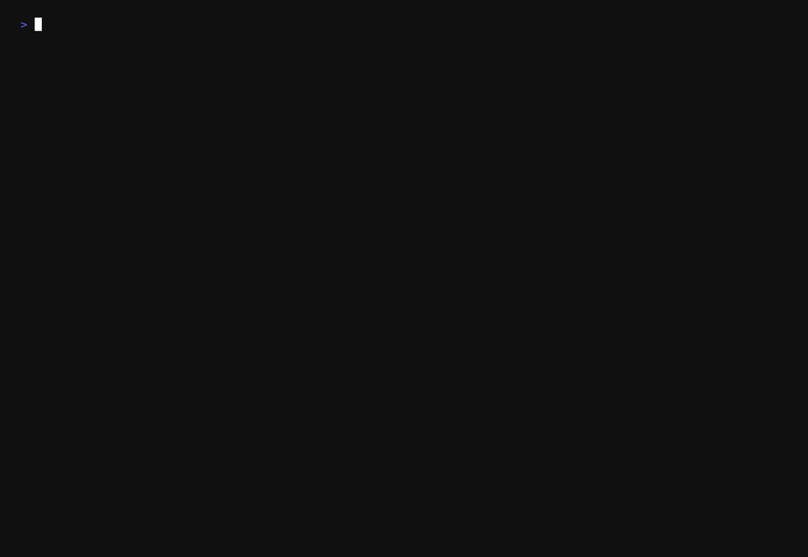

# StructAura

Deterministic AST fingerprinting for JavaScript and TypeScript.

StructAura parses source into a syntax tree, applies a limited set of syntax-only normalizations, and produces a versioned SHA-256 Merkle fingerprint. Formatting and comments can change without changing the fingerprint; structural changes should change it.

> **Scope:** StructAura is a structural fingerprinting tool. It is not a JavaScript runtime, type checker, semantic-equivalence prover, or source formatter.

## Features

- JavaScript and TypeScript parsing via Tree-sitter
- Deterministic canonical representation and domain-separated SHA-256 hashing
- Explicit fingerprint-format and language-normalization versions
- Compatibility checks that reject fingerprints from different languages or versions
- Syntax errors surfaced as JavaScript `Error` objects with useful diagnostics
- Browser-facing WebAssembly package backed by the same Rust core
- Iterative AST canonicalization and Merkle traversal (no recursive application-level traversal)

## Install

```sh
npm install @weluvabid/structaura
```

The published package is an ESM browser build targeting `wasm32-unknown-unknown`. It is intended for browsers and browser bundlers. It is not a native Node.js implementation.

## Quick start

```ts
import {
  init,
  fingerprintJavaScript,
  fingerprintTypeScript,
  compareFingerprints,
} from "@weluvabid/structaura";

await init();

const before = fingerprintJavaScript(`
  // A comment does not affect the fingerprint.
  const total = left + right;
`);

const after = fingerprintJavaScript("const total=(left+right)");

console.log(before.value === after.value); // true
console.log(before.digest);                // 64-character lowercase SHA-256 hex
console.log(before.language);              // "javascript"
console.log(before.formatVersion);         // 1
console.log(before.normalizationVersion);  // 1

const compatible = compareFingerprints(before, after);
console.log(compatible); // true
```

TypeScript source uses the TypeScript grammar:

```ts
const typed = fingerprintTypeScript("const count: number = 3;");
console.log(typed.value);
```

A generic entry point is also available:

```ts
import { init, fingerprintSource } from "@weluvabid/structaura";

await init();

const result = fingerprintSource("const enabled = true;", "javascript");
// Supported language identifiers: "javascript", "typescript"
```

`init()` is asynchronous and idempotent. Fingerprint operations are synchronous after initialization. For large inputs, run fingerprinting in a Web Worker so parsing does not block the UI thread.

## Fingerprint contract

A fingerprint contains:

| Field                  | Description                                      |
|------------------------|--------------------------------------------------|
| `value`                | Complete versioned fingerprint string            |
| `digest`               | SHA-256 digest (64 lowercase hex characters)     |
| `language`             | `"javascript"` or `"typescript"`                 |
| `formatVersion`        | Fingerprint serialization format version         |
| `normalizationVersion` | Language-specific canonicalization version       |

`compareFingerprints(left, right)` returns `true` or `false` for compatible fingerprints. It throws when format, language, or normalization versions differ. Do not compare only `digest` across different identities.

The compatibility identity and normalization boundaries are defined in the [fingerprint contract](docs/fingerprint-contract.md).

## Architecture

The Rust workspace is split by responsibility. Browser parsing uses the official Tree-sitter WebAssembly runtime:

| Crate                  | Responsibility                                                                 |
|------------------------|---------------------------------------------------------------------------------|
| `structaura-core`      | Canonical IR, deterministic encoding, Merkle hashing, fingerprint identity      |
| `structaura-javascript`| JavaScript parsing, diagnostics, and syntax-record extraction                   |
| `structaura-typescript`| TypeScript parsing, diagnostics, and syntax-record extraction                   |
| `structaura`           | Unified native Rust API and language dispatch                                   |
| `structaura-wasm`      | Shared Rust canonicalization + hashing exposed through `wasm-bindgen`           |

The browser adapter uses `web-tree-sitter` to parse source and sends a flat preorder syntax representation into the Rust WASM module. Both the native adapters and the browser package use `structaura-core` for canonicalization and hashing.

See the [architecture](docs/architecture.md), [error model](docs/error-model.md), and [WebAssembly build pipeline](docs/wasm.md).

## Development

**Requirements**

- Rust toolchain from `rust-toolchain.toml`
- `wasm32-unknown-unknown` target
- Node.js 26 and npm (development and release tooling only)
- `wasm-pack`

Native checks:

```sh
./scripts/check.sh
```

Browser package build and tests:

```sh
npm install
npm run build
wasm-pack test --node crates/wasm
npm test
```

The generated `pkg/` directory is intentionally ignored by Git. `npm run release:verify` runs the native checks, builds the WASM and grammar assets, runs WASM and JavaScript integration tests, and validates the npm package contents. The same command runs automatically through `prepublishOnly`. See the [release procedure](docs/release.md) before publishing.

Install the repository's pre-commit hook once per clone:

```sh
./scripts/install-hooks.sh
```

The hook runs formatting, Clippy with warnings denied, and the Rust workspace tests. CI remains authoritative and additionally validates the browser package and WASM integration.

## Benchmarks

StructAura measures the complete parse-to-fingerprint path for JavaScript and TypeScript, from
small source snippets to inputs of roughly 70 KB. In the recorded release-build run, small inputs
completed in under 116 µs median latency; the largest measured inputs completed in approximately
12–14 ms at p95. The benchmark also exposes parse, canonicalization, encoding, and Merkle stages
for deeper pipeline analysis.

See [benchmark results and methodology](docs/benchmarks.md) for the complete measurements,
sample methodology, and reproduction command:

```sh
./scripts/bench.sh
```



The recording is generated with VHS using [`benchmarks/benchmark.tape`](benchmarks/benchmark.tape).

## License

StructAura is dual-licensed under either the [MIT License](LICENSE-MIT) or the [Apache License, Version 2.0](LICENSE-APACHE), at your option. Third-party components and their license notices are documented in [THIRD_PARTY_NOTICES.md](THIRD_PARTY_NOTICES.md).
